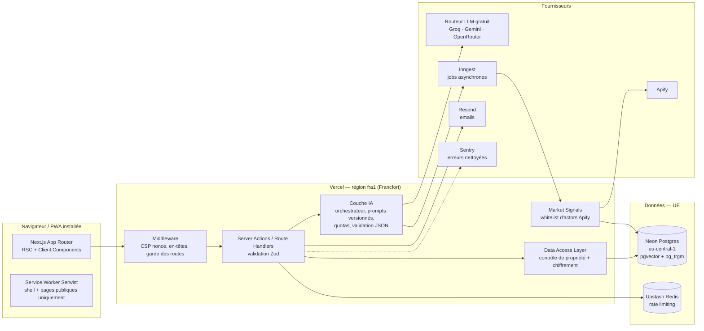

# Idevia — Architecture technique (proposition v1)

> Statut : proposition à valider avant le développement.
> Base : `Idevia_cahier_des_charges.md` v1.0 + exigences complémentaires :
> diagnostic adaptatif piloté par un modèle, PWA installable (mobile + bureau),
> exploitation de `API-mega-list`, stack Next.js + Neon, déploiement sur un domaine name.com.

---

## 1. Vue d'ensemble



Principe directeur : **un seul déploiement Next.js** (monolithe modulaire), aucune clé côté navigateur,
tout appel externe passe par le serveur, toute donnée utilisateur passe par la DAL.

---

## 2. Stack

| Couche | Choix | Raison |
|---|---|---|
| Framework | **Next.js 16.4 (App Router, Cache Components) + TypeScript strict** | SSR/SSG pour le SEO, Server Actions, un seul déploiement |
| UI | **Tailwind CSS v4 + shadcn/ui (Radix)** + skill `ui-ux-pro-max` | Composants accessibles, design system tokenisé |
| Base de données | **Neon Postgres** (région `eu-central-1`) | Serverless, branches par environnement (dev / preview / prod) |
| ORM / migrations | **Drizzle ORM + drizzle-kit** | Schéma typé, migrations SQL versionnées et relisibles |
| Recherche | **pg_trgm + full-text français**, **pgvector** pour la recherche sémantique | Pas de base vectorielle séparée |
| Authentification | **Better Auth** (tables dans Neon) | Email + mot de passe, lien magique, vérification email, 2FA TOTP (obligatoire pour les admins), rôles |
| IA | **Routeur multi-fournisseurs gratuits** (voir 2.1) dans `server/ai` | Sorties structurées (JSON validé par Zod), bascule automatique |
| Jobs asynchrones | **Inngest** | Génération de plans, appels Apify (30 s à plusieurs minutes), reprises automatiques |
| Rate limiting | **Upstash Redis** (`@upstash/ratelimit`) | Limites par IP et par utilisateur sur les endpoints sensibles |
| Emails | **Resend** + React Email | Bienvenue, vérification, réinitialisation, « ton plan est prêt » |
| PWA | **Service worker écrit à la main** (`public/sw.js`, ~60 lignes) | Contrôle total : rien de privé n'est mis en cache |
| Analytics | **First-party** : table `analytics_events`, sans cookie | Aucun coût, aucune donnée chez un tiers |
| Monitoring | **Sentry** avec nettoyage (`beforeSend`) | Aucune donnée personnelle ni jeton dans les erreurs |
| Hébergement | **Vercel** (région `fra1`) | Compatible Next.js ; DNS name.com pointé à la fin |
| Tests | Vitest (unitaires), Playwright (e2e + tests d'isolation des données) | Critères d'acceptation 9 et 10 testés automatiquement |

### 2.1. Contrainte « lancement à 0 € » (décision du 27/10/2026)

Aucun abonnement payant. Uniquement des offres gratuites ou des crédits gratuits récurrents.
Les quotas gratuits exacts sont **à vérifier au moment de l'intégration** (ils changent souvent).
Tous les identifiants de modèles sont configurables par variable d'environnement.

| Besoin | Service gratuit retenu | Garde-fou |
|---|---|---|
| LLM rapide (entretien adaptatif) | **Groq** (free tier, modèles open-weight, très faible latence) | Repli : Cerebras puis la banque de questions déterministe |
| LLM qualité (portrait, idées, plan) | **Google Gemini API** (free tier, modèle Flash) | Repli : OpenRouter (modèles `:free`) |
| Assistant | Groq, puis Gemini en repli | **Quota de tokens gratuit par utilisateur**, avec une offre « Pro » plus tard |
| Embeddings | Gemini embeddings (free tier) | Full-text Postgres si le quota est atteint |
| Signaux de marché | **Apify, plan gratuit** (crédits mensuels offerts) | Cache de 30 jours, déclenchement à la demande, coupe-circuit à 90 % des crédits |
| Base de données | Neon Free | Purge des données expirées pour rester sous la limite de stockage |
| Jobs | Inngest Free | |
| Rate limiting | Upstash Redis Free | |
| Emails | Resend Free | Un domaine vérifié (le domaine name.com) |
| Erreurs | Sentry Developer (gratuit) | |
| Analytics | **First-party** (table `analytics_events`) : pas d'outil tiers | Aucun cookie, aucun coût |
| Hébergement | Vercel Hobby **pendant le développement et la bêta** | ⚠️ Le plan Hobby interdit l'usage commercial : migrer (Vercel Pro, Netlify ou Cloudflare) **au moment d'activer le paiement**. Le code reste portable (aucune fonctionnalité propre à Vercel). |

**Modèles retenus (mesurés le 27/10/2026, offres gratuites)** : une « voie » = un fournisseur + un modèle,
chacune configurable par variable d'environnement (`AI_MODEL_*`) et testable avec `npm run ai:check`.

| Voie | Modèle | Mesure | Quota gratuit constaté | Rôle |
|---|---|---|---|---|
| `groq_fast` | qwen/qwen3.8-27b | ~0,5 s | limite de tokens/minute | Entretien, second générateur d'idées |
| `groq_reasoning` | openai/gpt-oss-120b | ~5 s, raisonne | ~1 000 req/jour, tokens/minute limités | Juge, portrait, rédaction |
| `gemini` | gemini-3.5-flash | 9 à 30 s, meilleure plume | **20 requêtes/jour** | Rédaction de l'idée n°1 tant qu'il reste du quota |
| `gemini_lite` | gemini-3.5-flash-lite | 1,5 à 10 s | large | Générateur d'idées, filet de sécurité partout |
| `openrouter` | nemotron-3-ultra (gratuit) | instable, souvent > 90 s sur les textes longs | ~50 req/jour sans crédit | Dernier recours |

Mesures en conditions réelles : une génération d'idées complète prend 30 à 70 s. Avec deux utilisateurs
simultanés, les limites par minute sautent ; le routeur patiente si la limite se lève en moins de 8 s, sinon
passe à la voie suivante, et met de côté une voie dont le quota du jour est épuisé (délai lu dans la réponse).
**Capacité estimée en gratuit : quelques dizaines de générations d'idées par jour.** Pour monter en charge, une
clé payante Gemini Flash Lite ou Groq coûte quelques centimes par génération ; à prévoir avec l'offre Pro.

**Routeur LLM** (`server/ai/router.ts`) : chaque tâche (`interview`, `portrait`, `ideation`, `plan`, `assistant`)
déclare une chaîne de fournisseurs. Le routeur gère les erreurs 429, les timeouts et un circuit breaker par fournisseur,
puis enregistre les tokens consommés dans `ai_usage`. Changer de modèle ne demande qu'une variable d'environnement.

**Confidentialité et offres gratuites** : certaines offres gratuites (Gemini notamment) peuvent utiliser
les requêtes pour améliorer leurs produits. Mesures prises :
1. aucune donnée identifiante (nom, email, id) n'est envoyée ;
2. le profil est pseudonymisé et résumé avant l'envoi ;
3. l'assistant (le contenu le plus personnel) passe en priorité par un fournisseur dont les conditions
   excluent l'entraînement sur les données de l'API (à confirmer dans les CGU de Groq au moment de l'intégration) ;
4. la politique de confidentialité nomme chaque sous-traitant.

**Précision sur API-mega-list** : la liste ne contient **aucun LLM gratuit**. Ses entrées « AI » sont aussi
des actors Apify payants à l'usage. Les modèles viennent donc des offres gratuites ci-dessus. La liste sert aux
signaux de marché (avec les crédits gratuits Apify) et au catalogue d'outils.

### 2.2. Monétisation prévue (sans coût fixe)

- Table `plans` (`free`, `pro`) et `usage_quotas` dès le MVP. L'offre gratuite inclut un quota mensuel de tokens
  pour l'assistant, d'analyses de marché et de régénérations.
- Bouton « Passer à Pro » : liste d'attente au lancement, puis paiement via un agrégateur africain **sans
  abonnement fixe**, avec commission par transaction (CinetPay, FedaPay ou PayDunya : Mobile Money Orange, MTN,
  Moov, Wave, ainsi que la carte bancaire). Le choix dépendra du pays d'immatriculation de l'entreprise.

---

## 3. Structure du dépôt

```
idevia/
├─ src/
│  ├─ app/
│  │  ├─ (marketing)/            # pages publiques indexables (SSG/ISR)
│  │  │  ├─ page.tsx             # accueil
│  │  │  ├─ comment-ca-marche/ fonctionnalites/ tarifs/ faq/ contact/
│  │  │  ├─ blog/[slug]/ ressources/[slug]/
│  │  │  └─ legal/ (cgu, confidentialite, mentions-legales, cookies)
│  │  ├─ (auth)/                 # connexion, inscription, mot de passe — noindex
│  │  ├─ diagnostic/             # entretien adaptatif — noindex
│  │  ├─ (app)/                  # espace connecté — noindex, auth requise
│  │  │  ├─ tableau-de-bord/
│  │  │  ├─ projets/[id]/ (idees, validation, plan, taches, assistant)
│  │  │  └─ compte/ (profil, données, export, suppression)
│  │  ├─ admin/                  # rôle admin + 2FA requis — noindex
│  │  ├─ api/                    # auth, inngest, webhooks, export
│  │  ├─ sitemap.ts  robots.ts  manifest.ts  sw.ts
│  ├─ server/
│  │  ├─ db/ (schema/, migrations/, client.ts)
│  │  ├─ dal/                    # SEUL point d'accès aux données utilisateur
│  │  ├─ ai/
│  │  │  ├─ interviewer/         # moteur du diagnostic adaptatif
│  │  │  ├─ ideation/            # génération + score + explications
│  │  │  ├─ planner/             # plan de lancement + tâches 30 jours
│  │  │  ├─ assistant/           # assistant contextualisé
│  │  │  ├─ prompts/             # prompts versionnés
│  │  │  └─ guard.ts             # quotas, coûts, validation, timeouts
│  │  ├─ market-signals/         # whitelist Apify + normalisation + cache
│  │  ├─ catalog/                # ingestion et recherche API-mega-list
│  │  ├─ crypto.ts               # chiffrement des champs sensibles
│  │  ├─ ratelimit.ts  audit.ts  analytics.ts
│  │  └─ jobs/                   # fonctions Inngest
│  ├─ components/ (ui/, marketing/, app/, admin/)
│  └─ lib/ (validation Zod partagée, utils)
├─ scripts/ingest-api-catalog.ts
├─ tests/ (unit/, e2e/, security/)
└─ docs/
```

---

## 4. Le diagnostic adaptatif (entretien piloté par un modèle)

Le diagnostic n'est pas une liste de questions figée. C'est un **entretien** : à chaque réponse,
le modèle met à jour un profil structuré puis choisit la question suivante la plus utile.

### 4.1. Le profil structuré

L'état de l'entretien est un objet typé, avec un niveau de confiance par dimension :

```ts
type ProfileState = {
  dimensions: {
    market:      Slot<{ country: string; region?: string; scope: "local" | "national" | "international" }>;
    goal:        Slot<{ type: "complement" | "principal" | "scale"; horizon: string }>;
    skills:      Slot<{ items: string[]; experience: string[] }>;
    interests:   Slot<{ sectors: string[]; excluded: string[] }>;
    resources:   Slot<{ budgetRange: string; hoursPerWeek: number; assets: string[] }>;
    preferences: Slot<{ channel: string; offerType: string; salesComfort: number }>;
    constraints: Slot<{ items: string[] }>;
    motivations: Slot<{ why: string; values: string[] }>;  // ce qui rend le profil unique
  };
  insights: string[];       // observations du modèle (« aime enseigner », « réseau dans la restauration »)
  contradictions: string[]; // points à clarifier
  turn: number;
};
type Slot<T> = { value: T | null; confidence: 0 | 1 | 2 | 3; source: "user" | "inferred" };
```

### 4.2. Boucle d'un tour

1. L'utilisateur répond (choix, curseur, ou texte libre).
2. **Extraction** : le modèle met à jour `ProfileState` (sortie JSON validée par Zod).
3. **Choix de la question suivante** : le modèle reçoit l'état et renvoie une question typée :
   ```ts
   type NextQuestion = {
     id: string;
     intent: keyof ProfileState["dimensions"] | "deepen" | "clarify";
     prompt: string;                 // formulée avec les mots de l'utilisateur
     kind: "single" | "multi" | "scale" | "text" | "budget";
     options?: { value: string; label: string }[]; // toujours avec « Je ne sais pas encore »
     why?: string;                   // « Je te demande ça parce que… » (transparence)
   };
   ```
4. **Garde-fous serveur** :
   - 18 questions maximum, minimum 8 ; arrêt dès que chaque dimension obligatoire atteint la confiance 2 ;
   - priorité aux dimensions les moins renseignées ; une contradiction déclenche une question de clarification ;
   - aucune question sur des données inutiles (âge, revenus exacts, santé, religion…) : liste interdite vérifiée côté serveur ;
   - **repli déterministe** : si le modèle échoue, est trop lent (plus de 8 s) ou renvoie un JSON invalide,
     une banque de questions de secours prend le relais pour la dimension la plus faible. L'entretien ne bloque jamais.
5. **Miroir** (fin d'entretien) : « Voici ce que j'ai compris de toi ». Un portrait rédigé que l'utilisateur
   **valide ou corrige** avant la génération des idées. C'est le moment où il se sent compris.

Modèles : un modèle rapide (Groq) pour l'extraction et le choix de question (faible latence),
un modèle de meilleure qualité (Gemini Flash) pour le miroir, les idées et le plan (voir 2.1).

**Implémentation** (`src/server/diagnostic/`) :
- **un seul appel au modèle par tour** : l'analyse (étapes 2) et la question suivante (étape 3) sont renvoyées
  dans le même JSON, ce qui divise par deux la latence et la consommation des quotas gratuits ;
- la première question est fixe et ouverte (« qu'est-ce qui te donne envie d'entreprendre ? ») : elle donne au modèle
  la matière pour personnaliser toute la suite ;
- si le modèle échoue sur une réponse libre, la réponse est gardée « en attente » et réanalysée au tour suivant ;
- les emails, téléphones et liens sont masqués avant tout envoi à un fournisseur (`server/ai/scrub.ts`) ;
- le portrait peut être corrigé 3 fois ; les corrections sont conservées dans le profil et priment pour la suite ;
- sans aucune clé d'API, l'entretien fonctionne entièrement avec la banque de secours (testé de bout en bout).

### 4.3. Anonyme, puis compte

Le diagnostic commence sans compte. Le cookie `__Host-idevia-diag` (`httpOnly`, `Secure`, `SameSite=Lax`, 7 jours)
contient un jeton aléatoire de 256 bits ; la base n'en stocke que le hachage SHA-256. Les lignes anonymes
(`user_id IS NULL`) ne sont lisibles qu'en contexte système, et chaque requête filtre explicitement sur ce hachage.

Après inscription ou connexion, `/diagnostic` et le tableau de bord redirigent vers `/diagnostic/rattacher`,
qui rattache l'entretien au compte, reporte pays, ville et devise sur le profil, puis supprime le cookie.
Les diagnostics anonymes non rattachés sont **supprimés au bout de 7 jours** par une tâche quotidienne
(`/api/cron/purge`, protégée par `CRON_SECRET`, planifiée dans `vercel.json`).

---

## 5. Exploitation de API-mega-list

### 5.1. Ce que contient réellement la liste

Environ 11 860 entrées uniques, **toutes des actors Apify** (scrapers et outils payants à l'usage),
réparties en 24 catégories. Les liens contiennent le code d'affiliation de l'auteur (`?fpr=p2hrc6`).
On l'exploite de trois façons.

### 5.2. Usage 1 : catalogue indexé (« boîte à outils personnalisée »)

- `scripts/ingest-api-catalog.ts` lit les README, déduplique, **retire le paramètre d'affiliation**,
  classe chaque entrée (catégorie, usage, risque données personnelles) et l'insère dans `api_catalog`.
- Recherche hybride : full-text français + trigrammes, puis re-classement par le modèle.
- Sur chaque idée et chaque tâche, Idevia propose **3 à 5 outils concrets** adaptés
  (ex. idée e-commerce → suivi de prix concurrents ; service local → analyse d'avis Google Maps).

### 5.3. Usage 2 : signaux de marché réels (validation sourcée)

Une **whitelist** d'une dizaine d'actors, appelés côté serveur via l'API Apify, dans un job Inngest :

| Signal | Exemple d'actor | Ce qu'il apporte à l'utilisateur |
|---|---|---|
| Concurrence locale | Google Maps Scraper | Nombre de concurrents dans sa ville (Dakar, Abidjan, Ouagadougou, Douala…), notes, fourchettes de prix |
| E-commerce africain | Jumia Product Search Scraper | Prix pratiqués, nombre d'offres, avis, sur les marchés où Jumia est présent (Côte d'Ivoire, Sénégal, Maroc…) |
| Tendances | Google Trends (intérêt par pays et requêtes associées) | Évolution de l'intérêt pour le sujet dans le pays ciblé |
| Publicité concurrente | Meta Ads « Click-to-WhatsApp » | Qui fait déjà de la publicité sur cette niche et avec quelles offres |
| Irritants clients | Analyse d'avis Google Maps / Trustpilot / G2 | Ce que les clients reprochent aux concurrents = angle de différenciation |
| Douleurs exprimées | Reddit Scraper | Problèmes réels formulés par de vrais gens |
| Demande de recherche | Autocomplete / SERP | Ce que les gens cherchent sur ce sujet |
| Produits physiques | Amazon / Etsy | Prix, avis, saturation |
| Produits numériques et SaaS | Product Hunt, G2 | Lancements récents, positionnement |
| Demande de compétences | Scrapers d'offres d'emploi | Besoin du marché pour une compétence de service |

Règles :
- Chaque signal stocke **source, URL, date de collecte, requête utilisée et limites** : affiché tel quel
  (exigence du cahier des charges « citer les sources, dater, ne rien inventer »).
- **Exclusion des actors qui collectent des emails ou contacts personnels** (catégorie lead-generation) :
  incompatible avec le RGPD pour notre usage. Les sorties sont filtrées pour ne garder que des données agrégées.
- Cache partagé de 30 jours par (actor, requête normalisée, pays) pour limiter les coûts.
- Budget plafonné : coût par run suivi dans `ai_usage`, quota par utilisateur, coupe-circuit global mensuel.
- Les données collectées sont traitées comme **non fiables** (protection contre l'injection de prompt) :
  passées au modèle dans un bloc délimité, jamais interprétées comme des instructions.

### 5.4. Usage 3 : inspiration pour l'idéation

La répartition du catalogue (niches où de nombreux outils existent, ce qu'on automatise souvent) alimente
le générateur d'idées en exemples concrets, notamment pour les profils techniques (micro-SaaS, service de données,
automatisation pour PME).

### 5.5. Public : les francophones, en Afrique, en Europe et ailleurs (élargi le 27/10/2026)

- Public visé : l'Afrique francophone, l'Europe francophone (France, Belgique, Suisse, Luxembourg, Monaco),
  le Canada et l'océan Indien. Le diagnostic demande **où vit la personne** et, séparément, **où elle imagine ses
  clients** : près de chez elle, dans tout son pays, en ligne, ou entre deux pays (diaspora, import-export).
- **Le lieu de vie ne limite pas les idées.** Il fixe la monnaie, les coûts et les démarches, pas le marché.
  Les générateurs doivent proposer des idées au-delà de la ville (en ligne, nationales, transfrontalières), et la
  sélection garde au moins une idée de ce type parmi les trois si elle est presque aussi bien notée (12 points
  d'écart au plus), sauf si la personne a dit vouloir des clients proches. Chaque idée affiche sa portée.
- Budgets dans la devise du pays de résidence (FCFA, €, CHF, $ CA…), avec des fourchettes adaptées.
- Canaux adaptés au marché visé : WhatsApp Business et Mobile Money en Afrique de l'Ouest, Instagram,
  marketplaces et plateformes de freelances en Europe, groupes de la diaspora pour un pont entre deux pays.
- Démarches présentées comme des pistes à vérifier, jamais comme un conseil juridique : secteur informel accepté
  comme point de départ et cadre OHADA en Afrique, micro-entreprise en France, indépendant complémentaire en Belgique…
- **Performance sur réseau lent et téléphones d'entrée de gamme** : objectif de JS initial inférieur à 150 Ko
  sur les pages clés, images légères, PWA qui charge le shell hors-ligne.
- Protection des données : RGPD (serveurs dans l'UE) et lois nationales (CDP Sénégal, ARTCI Côte d'Ivoire,
  CIL Burkina Faso, LPD Suisse, Loi 25 Québec…) à mentionner dans la politique de confidentialité.

### 5.6. Ce qui rend chaque utilisateur unique

- Le **miroir** validé (section 4.2) est la référence de toutes les générations.
- Chaque idée comporte « **Pourquoi toi** » : des raisons qui citent ses propres réponses (« tu as dit que… »).
- Le score de compatibilité est **décomposé** par critère (compétences, budget, temps, préférences, marché),
  jamais présenté comme une probabilité de réussite.
- Les signaux de marché sont **ciblés sur sa ville et son pays**, pas génériques.
- Une **mémoire de projet** (faits confirmés, décisions, apprentissages) est mise à jour au fil des tâches
  et des échanges avec l'assistant. Le plan s'adapte à ce qu'il a appris.
- Le ton s'adapte (tutoiement, niveau de détail débutant ou expérimenté, déduit du diagnostic).

---

### 5.7. Génération des idées (mis en place le 27/10/2026)

Trois idées seulement, classées de la plus à la moins pertinente, chacune avec un plan d'action sur 30 jours.
L'orchestration (`src/server/ideas/pipeline.ts`) :
1. **Divergence** : deux générateurs de familles de modèles différentes (Gemini, puis Groq/Cerebras) proposent
   6 idées chacun, sous deux angles : « ancrage » (ce que la personne sait déjà faire) et « audace » (niches, nouveaux canaux).
2. **Jugement** : un troisième modèle, distinct du générateur principal, note chaque idée de 0 à 10 sur six critères
   (compétences, demande locale, budget et temps, motivation, rapidité des premiers revenus, risque) et peut l'éliminer.
   Le score sur 100 est calculé côté serveur avec des poids fixes : il est stable et expliqué à l'utilisateur.
3. **Sélection** : les 3 meilleures, une par famille de modèle économique tant que c'est possible.
4. **Rédaction** : fiche et plan écrits en parallèle, au tutoiement, en petits paragraphes, avec des chiffres prudents
   en monnaie locale, une action à faire le jour même et les pièges à éviter.

La génération tourne en arrière-plan (`after`, `maxDuration = 300`) ; la page suit l'avancement. Quota :
`IDEAS_MONTHLY_QUOTA` générations par mois (3 par défaut, les échecs ne comptent pas). Les fiches sont chiffrées.

**Offre payante** (`IDEAS_PAYWALL`, désactivée au lancement) : un compte gratuit voit en entier la 3e idée, la moins
pertinente ; les deux meilleures et le suivi sont réservés à l'offre Pro. Le serveur n'envoie alors ni le titre ni le
contenu des idées verrouillées ; le bouton « Me prévenir » inscrit le compte sur la liste d'attente Pro.

## 6. PWA

- `app/manifest.ts` : nom, icônes (192, 512, maskable), `display: "standalone"`, `theme_color`,
  raccourcis (« Mes tâches », « Assistant »). Installable sur Android, iOS, Chrome/Edge bureau et macOS.
- Service worker minimal écrit à la main (`public/sw.js`) :
  - pré-cache du shell, des polices, des icônes et des pages publiques ;
  - page `/hors-ligne` de repli ;
  - **aucune mise en cache des réponses privées** (`/api`, `/(app)`, `/admin` en `NetworkOnly`) :
    sur un appareil partagé, rien de personnel ne reste dans le cache ;
  - à la déconnexion, purge des caches et de l'état client.
- Bouton « Installer Idevia » discret (événement `beforeinstallprompt`, instructions dédiées pour iOS).
- Notifications push Web : prévues en phase 2, avec consentement explicite.

---

## 7. Modèle de données (Neon)

Repris du cahier des charges, avec ces ajouts et changements :

| Table | Rôle | Remarques |
|---|---|---|
| `users`, `sessions`, `accounts`, `verifications`, `two_factors` | Better Auth | `role`: user / support / content / analyst / super_admin |
| `profiles` | Profil | pays, langue, niveau d'expérience |
| `diagnostics` | Entretien | `state` (ProfileState) **chiffré**, `anon_session_id`, `portrait` validé, `expires_at` |
| `diagnostic_turns` | Historique des tours | question posée + réponse **chiffrée** |
| `business_ideas` | Idées | `details` JSON, `score_breakdown`, `why_you`, `to_verify` |
| `projects` | Projets | `memory` JSON (faits, décisions, apprentissages) |
| `validations` | Hypothèses et tests | statut par hypothèse |
| `market_signals` | Signaux Apify | `source`, `url`, `collected_at`, `query`, `payload` agrégé, `limits` |
| `business_plans` | Plan versionné | sections avec `origin`: user / sourced / hypothesis / ai |
| `tasks` | Plan 30 jours | + `expected_result`, `notes`, `blocked_reason`, `resources` |
| `project_notes` | Notes | chiffrées |
| `assistant_conversations`, `assistant_messages` | Assistant | messages **chiffrés** |
| `api_catalog` | API-mega-list | `slug`, `name`, `description`, `category`, `pii_risk`, `embedding vector`, `tsv` |
| `ai_usage` | Coûts | modèle, tokens, coût estimé, fonctionnalité (pas de contenu) |
| `analytics_events` | Entonnoir | événement + propriétés minimales, **jamais de texte libre** |
| `posts`, `post_categories` | Blog SEO | slug, titre et méta SEO, alt des images, statut, date programmée |
| `admin_audit_logs` | Audit | action, cible, **justification obligatoire** pour l'accès à du contenu privé |
| `deletion_requests` | RGPD | délai de grâce de 30 jours puis purge définitive |

Index sur toutes les clés étrangères, `user_id` présent sur toutes les tables privées.

---

## 8. Sécurité et protection des données

### 8.1. Isolation des données (critère d'acceptation n°9)

Deux couches indépendantes :
1. **DAL applicative** : chaque fonction reçoit l'utilisateur de la session (jamais un `userId` venant du client)
   et filtre par propriété. Aucun composant n'importe directement le client de base de données
   (règle ESLint `no-restricted-imports`).
2. **Row-Level Security Postgres** : rôle applicatif sans `BYPASSRLS`, politiques `user_id = current_setting('app.user_id')`
   positionné dans chaque transaction. Un oubli dans la DAL est bloqué par la base.

Implémentation : `src/server/dal/context.ts` (`withUser` / `withSystem`) et `drizzle/0001_rls.sql`.
Sans contexte, une table privée ne renvoie aucune ligne (fail closed). Les tables internes (`ai_usage`, `analytics_events`,
`admin_audit_logs`) ne sont jamais lisibles depuis un contexte utilisateur.
Tests automatisés : l'utilisateur A tente de lire, modifier ou supprimer chaque ressource de B, ce qui doit renvoyer 404.

**Neon (mis en place le 27/10/2026)** : projet `aged-violet-60283264`, branche `production`, région Francfort
(`aws-eu-central-1`), Postgres 18, déclaré dans `neon.ts` (Postgres + Realtime) et appliqué avec `neon deploy`.
- `neondb_owner`, le rôle fourni par Neon, a **BYPASSRLS**. Il ne sert qu'aux migrations (`DATABASE_URL_UNPOOLED`,
  connexion directe). L'application se connecte avec `idevia_app` (sans BYPASSRLS, ni propriétaire), via le pooler
  (`DATABASE_APP_URL`, créé par `npm run db:app-role`).
- Pilote : `node-postgres` avec `attachDatabasePool` (recommandation Neon pour Vercel Fluid compute). Le contexte RLS
  (`set_config(..., true)`) est local à la transaction, donc compatible avec PgBouncer en mode transaction.
- **Realtime** (bêta) ne gère pas encore la RLS : une requête en direct sur une table sous RLS est rejetée
  (`upstream_rejected`). On ne lui expose donc que des **projections sans donnée sensible**, tenues à jour par trigger
  et illisibles pour `idevia_app` : `diagnostic_progress` (statut et nombre de réponses). Les requêtes sont scellées
  côté serveur, filtrées sur l'utilisateur de la session, et renouvelées par `POST /api/realtime/diagnostic`
  (401 si la page appartient à une autre session). Le navigateur ne peut se connecter qu'à l'origine Realtime (CSP).
  Usage actuel : le tableau de bord se met à jour en direct quand l'utilisateur répond depuis un autre appareil.

### 8.2. Chiffrement

- En transit : HTTPS uniquement, HSTS avec preload.
- Au repos : chiffrement natif de Neon, plus **chiffrement applicatif AES-256-GCM** des champs les plus sensibles
  (réponses du diagnostic, notes, messages de l'assistant), avec une clé versionnée (rotation possible) stockée
  uniquement dans les variables d'environnement serveur.
- Mots de passe : hachage scrypt (Better Auth), vérification contre les mots de passe compromis (HIBP, k-anonymity).

### 8.3. Application web

- **CSP hybride** (posée par `src/proxy.ts`, ex-middleware en Next 16) :
  - espaces privés (connexion, diagnostic, application, admin) : rendu dynamique (`instant = false`) et
    **CSP à nonce + `strict-dynamic`**. Vérifié : 100 % des scripts portent le nonce ;
  - pages publiques statiques : `script-src 'self' 'unsafe-inline'` + SRI, car Next 16 injecte des scripts inline dans
    le HTML pré-rendu, incompatibles avec un nonce. Risque limité : ces pages ne rendent aucun contenu saisi par un utilisateur.
- `frame-ancestors 'none'`, HSTS preload, `X-Content-Type-Options`, `Referrer-Policy: strict-origin-when-cross-origin`,
  `Permissions-Policy` restrictive, `Cache-Control: private, no-store` sur les espaces privés.
- Validation **Zod côté serveur** de chaque Server Action et Route Handler ; tailles maximales des entrées.
- Server Actions : contrôle d'origine natif de Next.js ; cookies `__Host-`, `Secure`, `httpOnly`, `SameSite=Lax`.
- Rate limiting : connexion (5/min par IP et par email), inscription, mot de passe oublié, endpoints IA, export.
- `server-only` sur tous les modules serveur, pour qu'aucun secret ne puisse être importé côté client.
- Dépendances : Dependabot, `npm audit` en CI, versions figées.

### 8.4. IA

- Appels uniquement depuis le serveur, avec des quotas par utilisateur, par jour et par fonctionnalité,
  plus un plafond global mensuel (coupe-circuit).
- **Minimisation** : le fournisseur IA ne reçoit jamais l'email, le nom ou l'identifiant ; seulement le profil
  structuré et le contexte du projet sélectionné (critère d'acceptation n°8).
- Sorties traitées comme non fiables : validation Zod, rendu Markdown sanitisé (pas de HTML brut).
- Protection contre l'injection de prompt : contenu utilisateur et données scrapées dans des blocs délimités ;
  l'assistant n'a **aucun outil à effet de bord** (il ne peut ni supprimer, ni envoyer, ni payer).
- Timeouts, reprises avec backoff, gestion des réponses incomplètes.

### 8.5. Administration

- Routes `/admin` protégées par le middleware **et** par une vérification de rôle côté serveur dans chaque action.
- **2FA TOTP obligatoire** pour tout rôle administrateur.
- Statistiques agrégées par défaut. L'accès au contenu d'un projet exige une justification écrite et crée une
  entrée dans `admin_audit_logs`, visible par le super administrateur.

### 8.6. RGPD et conservation

| Donnée | Durée |
|---|---|
| Diagnostic anonyme non converti | 7 jours |
| Compte inactif | 24 mois, avec email d'avertissement 30 jours avant suppression |
| Demande de suppression | 30 jours de grâce, puis purge définitive (sauvegardes Neon : rétention de 7 jours) |
| Signaux de marché (cache) | 30 jours |
| `analytics_events` | 13 mois, puis agrégation |
| Logs techniques | 30 jours |

- Export complet en JSON depuis l'espace compte (droit à la portabilité).
- Hébergement des données dans l'UE (Neon Francfort, Vercel fra1). Signer les DPA des sous-traitants
  (Groq, Google, OpenRouter, Vercel, Neon, Resend, Apify, Sentry, Upstash, Inngest) et les lister dans la politique de confidentialité.
- Ni les conversations ni les données utilisateur ne servent à entraîner un modèle.

### 8.7. Environnements et déploiement

- Branches Neon : `main` (prod), `preview` (une par PR via l'intégration Vercel), `dev`.
- CI GitHub Actions : lint, typecheck, tests unitaires, tests d'isolation, build, puis `drizzle-kit migrate` sur la branche cible.
- Secrets : variables d'environnement Vercel, jamais commités ; `.env.example` documenté.
- Sauvegardes : restauration à un instant donné (PITR) de Neon, avec un **test de restauration documenté** avant le lancement.
- Domaine : DNS name.com, enregistrements `A`/`CNAME` vers Vercel, HTTPS automatique, redirection `www` vers l'apex.

---

## 9. SEO

- Pages marketing et blog en SSG/ISR ; `generateMetadata` par page (titre, description, canonique, Open Graph).
- `sitemap.ts` dynamique (pages et articles publiés), `robots.ts` qui exclut `/diagnostic`, `/(app)`, `/admin`, `/api`.
- En-tête `X-Robots-Tag: noindex` sur tout l'espace privé (double protection).
- JSON-LD : `Organization`, `SoftwareApplication`, `FAQPage` (uniquement si la FAQ est visible), `Article`.
- Images `next/image` (AVIF/WebP), polices `next/font` auto-hébergées, objectif Core Web Vitals « bon » sur mobile.

---

## 10. Plan de réalisation

| Phase | Contenu | Livrable |
|---|---|---|
| 0 | Design system (skill ui-ux-pro-max), maquettes clés | Tokens, composants de base, page d'accueil |
| 1 | Socle : Next.js, Neon, Drizzle, Better Auth, DAL + RLS, en-têtes de sécurité, PWA | App déployée en preview avec comptes isolés |
| 2 | Diagnostic adaptatif + miroir | Entretien complet, anonyme puis rattaché au compte |
| 3 | Ingestion du catalogue + signaux de marché + génération d'idées | 3 idées personnalisées, sourcées, comparables |
| 4 | Validation, plan de lancement, tâches 30 jours, tableau de bord | Parcours principal opérationnel |
| 5 | Assistant contextualisé + mémoire de projet + emails | Accompagnement continu |
| 6 | Admin : rôles, 2FA, analytics, entonnoir, coûts, blog | Back-office utilisable |
| 7 | SEO, pages légales, tests e2e et sécurité, domaine name.com | MVP en production |
